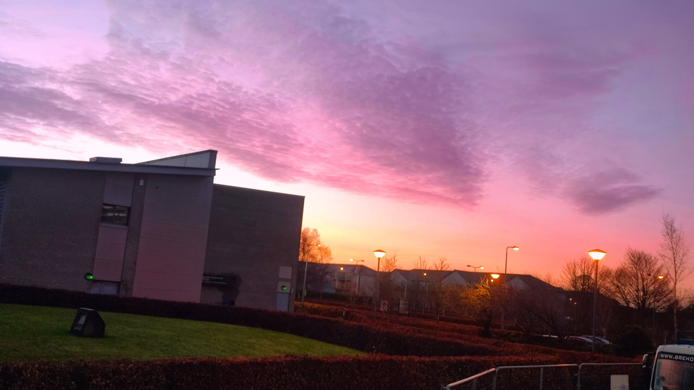
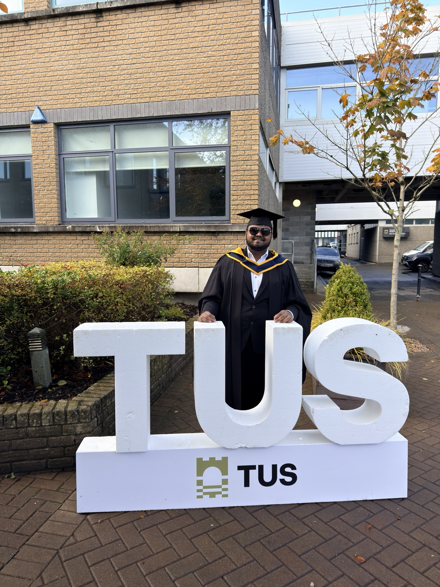
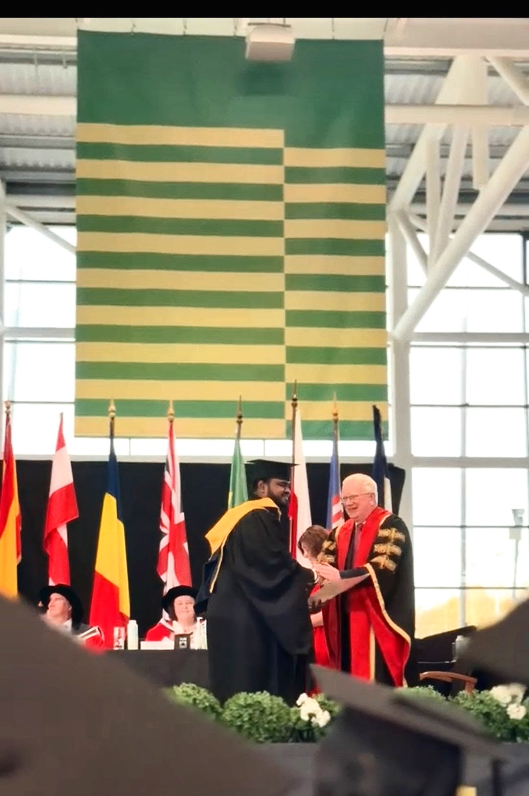
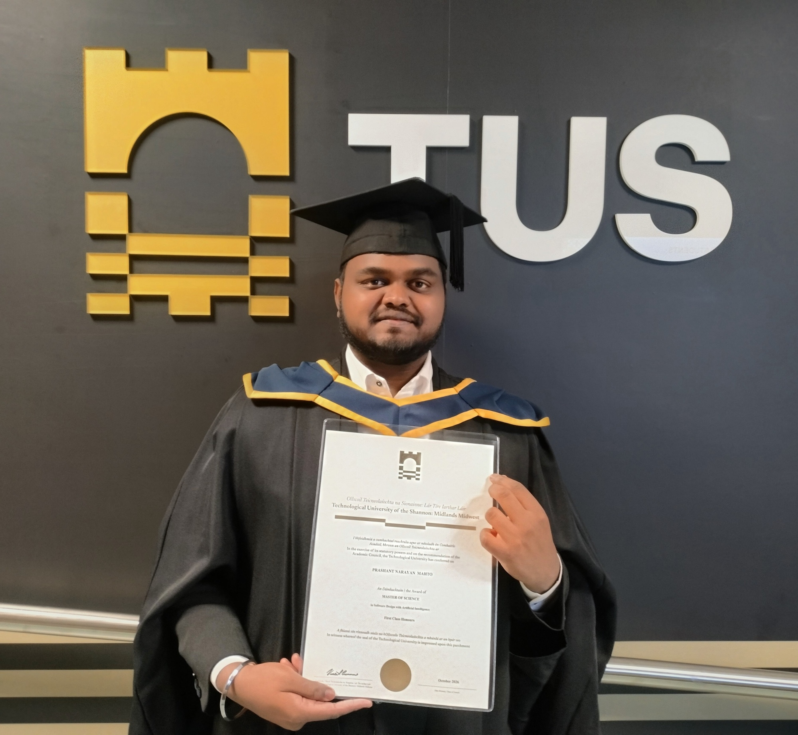

On 27th of October 2026 I completed my **Master's course of MSc in Software Design with AI** from **Technological University of Shannon - Athlone**. A huge congratulations to all my classmates and friends who graduated alongside me. It was forever a dream of mine to complete my Master's abroad ever since I got into the college. The stage walkout and receiving degree from the university president was exactly like I always dreamed.  Now that milestone achieved I want to take the moment and think about everything I have experienced so far in Ireland and this past one year of my course. First Ireland, and Athlone, it is a peaceful place with very friendly people it's very different from the place I came from. So, my conclusion is that I liked it. This is exactly the type of place, and  weather that I want to live in. Though I do miss the food and convenience of ordering whatever food I want at any time and I love Indian cuisine.  
&nbsp;&nbsp;&nbsp;&nbsp; Next, I want to talk about TUS - The campus is beautiful, big and the environment  is very welcoming. All lecturers are very friendly and they made everything very intuitive to learn. I hardly had any complications completing my course work. The campus gives the feeling of a Netflix scene sometimes.   
   
Over the past one year I have experienced many things. And with experiences you get a lot of lessons as well. Very first of which was cooking meals. Ever since childhood my mother always used to cook meals for me and I was very comfortable and kind of getting used to it. At first it was really tough to cook on my own, even though I had taken all sorts of tips from my mother cooking take a lot of patience and delicacy. I had to learn that cooking something good might take time. And the taste after the wait is always worth it. Another thing would be managing my own laundry, since it's another thing my mother used to do for me. The more time I spend away from my home, the more I realize how much my mother used to do for me. And that makes me more and more thankful to her. Talking about staying away from my home this is another thing that I was experiencing for the first time that being having to deal with Roommates. Living with seven other random people whom I didn't know was new to me. From having a room all to myself to sharing it someone I barely know was also part of it. But it turned out pretty well since all my roommates were really nice people themselves. Though there were some irritating parts of this experience, I still enjoyed it. Another thing that improved very well is my ability to talk with random people. To walk with other people in public setting using the words that does not belong to your first language is not easy and takes a lot of confidence since you do not want to offend the person in front of you. I know, a lot of international students will relate to this.  
&nbsp;&nbsp;&nbsp;&nbsp; Everything I have experienced and learned so far here in Ireland is all due the continuous efforts and hard work of my parents. I am and always will be thankful for everything they have done for me. Their constant support from hundreds of miles away from me is what kept me going up until this point. At last, I would also like to take this moment to thank myself for having the courage and willpower to get out of my comfort zone and face this part of my life head on. If you're an international student, you should be proud of yourself too. It takes a lot of courage to move to a country where you don't have any contacts and make a life for yourself. Moving ahead, I look forward to being a better version of myself. I also look forward to learning a lot of new stuff and getting to meet more people.   
   
   

